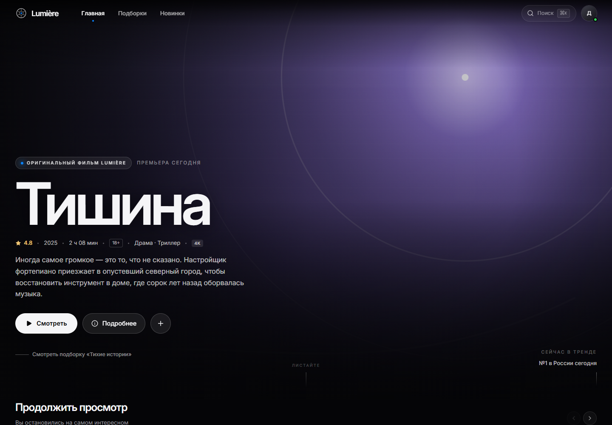

# Lumière — онлайн-кинотеатр в стиле Cupertino

Концепт стримингового сервиса: тёмный кинематографичный интерфейс, крупная
типографика, матовое стекло, аккуратные анимации и кураторские подборки.
Главная страница и раздел «Подборки» готовы к просмотру и клику.



## Стек

- **React 19 + TypeScript**
- **Vite 7**
- **Tailwind CSS 4** (`@tailwindcss/vite`)
- **Framer Motion** — появление героя, модальные окна, фильтрация сетки
- **React Router 7** — главная, подборки, страница подборки
- **Lucide React** — иконки

## Запуск

```bash
npm install
npm run dev
```

Откройте `http://localhost:5173`.

Сборка:

```bash
npm run build
npm run preview
```

## Что внутри

- **Главная**: полноэкранный герой, «Продолжить просмотр», тренды, подборка
  недели, новинки, выбор по настроению, подборки и рекомендации.
- **Подборки**: редакционная витрина, фильтры по настроению, сетка программ,
  случайный фильм.
- **Страница подборки**: кинематографичный герой, состав подборки, другие
  программы.
- **Карточка фильма**: постер, рейтинг, описание, факты, актёры, похожее.
- **Поиск** (`⌘K` / `Ctrl+K`): живой поиск по названиям, жанрам, режиссёрам.
- **Плеер**: демонстрационный интерфейс с прогрессом, паузой, субтитрами и
  полноэкранным режимом.
- **Мой список**: добавление фильмов с уведомлением.

## Об artwork

Все постеры и фоны сгенерированы процедурно в SVG (`src/components/Artwork.tsx`):
палитра и мотив задаются в данных фильма. Это позволяет проекту выглядеть
цельно без внешних изображений и работать офлайн.

## Структура

```
src/
  components/   интерфейс и переиспользуемые элементы
  data/         фильмы, подборки, настроения
  lib/          контекст кинотеатра, утилиты
  pages/        главная, подборки, подборка
  index.css     дизайн-токены Tailwind 4 и глобальные стили
```
